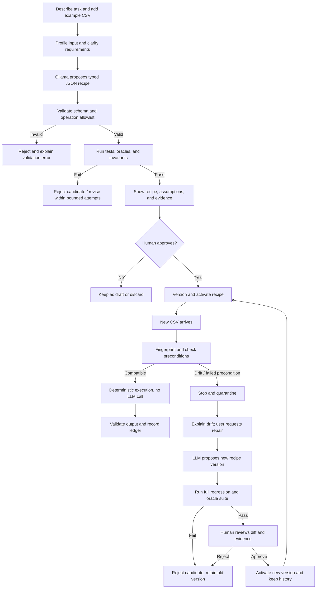

Molt — MVP & Workflow Specification
Product: Molt
Tagline: Compile once. Verify against truth. Reuse without repeated inference.
Category: Local-first, verified AI automation
MVP focus: Reusable CSV / expense-export transformations, with safe watched-folder execution
Model runtime: Ollama with a configurable local open-weight model
Core principle: The LLM proposes a constrained recipe; Molt's deterministic runtime executes it; independent tests verify it; a human approves recipe changes.
1. Product summary
Molt turns a repetitive, structured task into a reusable automation recipe. The user describes a task and provides an example CSV. A local LLM proposes a typed JSON recipe over a fixed operation registry. Molt validates the recipe, tests it against independently specified expected outputs and invariants, and asks the user to approve it. An approved recipe can then process compatible files without another LLM call.

When an input no longer matches the automation's assumptions, Molt must stop before silently producing a potentially incorrect output. It reports the drift, quarantines the file in watched-folder mode, and can ask the LLM to propose a new recipe version. The candidate is run against the complete regression suite and independent expected outputs. Human approval is required before the new version becomes active.

Molt is not a general-purpose agent or a code-generation wrapper. The important components are the constrained operation language, deterministic interpreter, independent verifier, drift detector, version history, and savings ledger. The model is replaceable: the same recipe runtime should work with different Ollama-supported models without changing execution semantics.
Problem
Users repeatedly ask an LLM to clean or transform similar CSV exports. Repeating prompts costs time, inference, and latency. Generating a Python script once can reduce repeated calls, but it does not inherently provide a constrained operation set, recipe-level diffs, independent verification, drift handling, human-controlled repairs, or a record of the work saved.
Product promise
For supported, repeatable CSV tasks, Molt reduces repeated model inference while making recipe behavior, verification evidence, drift, and repair decisions inspectable.
What Molt does not promise
- It does not prove that a recipe is correct for every possible input.
- It does not automatically repair every kind of drift.
- It does not execute arbitrary model-generated Python or shell commands.
- It does not guarantee zero silent wrong outputs outside the explicitly tested fixtures and measured conditions.
- It does not claim measured energy or electricity savings unless power is actually measured. The MVP reports inference and latency proxies.
2. Target users and primary demo
Target users
- Developers and technical students who repeatedly clean data exports
- Researchers working with structured datasets
- Event organizers processing participant lists
- Small teams normalizing CSV exports from different tools
Recommended demo task
Use a synthetic expense / transaction CSV, not a real bank statement. Show Molt standardizing date formats, trimming merchant names, mapping known categories, parsing amounts, and deduplicating transactions using explicitly chosen key columns.

Example task request:
Normalize this expense export. Trim merchant names, parse the transaction date into ISO format, map the known category aliases, parse the amount as a decimal, and remove duplicates using transaction ID. Preserve the original file and all columns not explicitly changed.

The user must specify or approve important semantics such as date formats, duplicate policy, decimal separators, mapping behavior for unknown categories, and whether row order must be preserved. Molt must not guess high-impact details silently.
Supported scope
The MVP focuses on CSV input and CSV output. Other file formats, browser automation, databases, spreadsheets with formulas, and general-purpose computer use are out of scope.
3. Core workflow at a glance

The LLM is absent from the ordinary execution path. It is used only when generating a recipe, proposing a repair, or when the user explicitly requests a new interpretation.
4. Main user journeys
Journey A — Create and graduate a recipe
1. User selects Create Automation.
2. User enters a plain-language task description and uploads a representative CSV.
3. Molt profiles the CSV: columns, row count, candidate data types, null counts, duplicate counts, delimiter, and a small sample preview.
4. Molt masks or omits sample values where practical and shows the user what contextual data will be sent to the local model.
5. If important semantics are ambiguous, Molt asks clarifying questions. Examples: which column defines duplicates, how to interpret 03/04/2026, or what to do with unknown category values.
6. User confirms the intended transformation and creates or reviews expected-output fixtures. The expected result must be independent of the recipe candidate; model-generated expected output is not ground truth unless a user reviews and approves it.
7. Molt requests a constrained JSON recipe from Ollama using the supported recipe schema.
8. The backend validates the JSON schema and then performs semantic checks: known operations only, valid arguments, declared columns, valid condition syntax, and safe file paths.
9. Molt runs the recipe on isolated fixture copies.
10. The verifier runs golden examples, invariants, applicable property tests, and regression tests.
11. If a mandatory check fails, the candidate is not eligible for approval. Molt explains the failure and may request a bounded re-generation.
12. If checks pass, Molt displays the recipe in readable form, its assumptions, test results, and any limitations.
13. User explicitly approves the candidate.
14. Molt saves a versioned recipe and marks it Active.
Graduation rule: Executing without an exception is not sufficient. Activation requires valid recipe structure, passing mandatory checks, and explicit human approval.
Journey B — Run an active recipe manually
1. User selects an active recipe and uploads a new CSV.
2. Molt fingerprints the input and validates the input contract.
3. If compatible, the deterministic interpreter executes the recipe without a model call.
4. Molt validates output invariants and writes the result to a new output path via a temporary file.
5. Only after successful validation is the output finalized.
6. Molt records the recipe version, file fingerprint, status, duration, rows read/written, validation evidence, and LLM calls used.
7. The dashboard shows the output path and a run report.
If a precondition fails or output validation fails, the run is not reported as successful. Original input files are preserved by default.
Journey C — Watched-folder / lazy mode
The user can enable a local folder workflow:
workspace/
├── in/             # Drop incoming CSV files here
├── done/           # Validated outputs and/or completed input copies
├── quarantine/     # Drifted or invalid files; never silently process
├── reports/        # Per-run JSON or Markdown reports
└── archive/        # Optional originals archive, if enabled
Workflow:
1. The local watcher detects a new file in in/ and waits until its size is stable across checks, so it does not read a file while it is still being copied.
2. It validates that the file is within the configured root, is a supported file type, and is under configured size limits.
3. It identifies the active recipe selected for the folder and computes the input/schema fingerprint.
4. If the fingerprint and input contract are compatible, Molt runs the recipe deterministically.
5. If output checks pass, Molt writes the output atomically into done/ and writes a report into reports/.
6. If the schema is incompatible, parsing fails, or an invariant fails, Molt moves or copies the file into quarantine/ without overwriting it and writes a drift report.
7. Repair is not automatic. A user can review the drift report and request a repair proposal.
8. Each file is processed at most once per recorded fingerprint/run policy. Duplicate events must not cause duplicate outputs.
For a compact local MVP, polling the folder periodically is acceptable; a separate queue system is unnecessary. Folder roots must be configured by the user. The watcher must not move, delete, or overwrite files outside those roots.

A daily or on-demand digest can summarize processed files, quarantined files, failures, actual model calls, and estimated calls avoided. This summary is based on run records, not invented values.
Journey D — Drift detection and re-molt (repair)
1. A new file is found with a missing or renamed required column, an unexpected type, a new categorical value, a changed date format, or another violated precondition.
2. Molt blocks execution before delivering an unverified result. In watched mode, it quarantines the file.
3. The drift report explains expected versus observed schema and identifies the exact assumption that failed.
4. The user may cancel, fix the input, or request a repair proposal.
5. Molt sends the model the active recipe, relevant schema difference, failure report, and only the necessary sample data.
6. The model proposes a new recipe version. The candidate is stored separately; the active recipe is not changed.
7. Molt runs semantic validation and the entire accumulated regression suite, including earlier golden cases, applicable property tests, and the drifted fixture where an expected result has been established.
8. A failed mandatory check makes the candidate ineligible for promotion.
9. If checks pass, Molt displays an operation-level diff, test evidence, and uncertainties.
10. The user explicitly approves or rejects the candidate.
11. Only a verified and approved candidate becomes active as a new version, such as v1 → v2.
12. The previous recipe remains available for rollback. Rejected proposals and failed test results remain in history.
Human approval is necessary but not sufficient: verification must pass before a repair can be activated. If the correct column mapping or transformation is ambiguous, Molt must ask the user to define the intended behavior instead of guessing.
5. Typed operation DSL
The LLM emits a structured recipe, never executable code. The backend interprets only known operations from a fixed registry.
Initial operation registry
Keep the operation set focused on the demo chore. The following operations are candidates for the first version; implement only operations with defined behavior and tests.
Operation	Purpose	Required policy / constraints
rename_column	Rename a column	Source must exist; destination collision policy must be explicit
trim	Trim leading/trailing whitespace	Selected columns only
normalize_case	Lowercase, uppercase, or title case	Explicit mode; avoid changing case where semantics require preservation
coerce_date	Parse and format dates	Explicit input format(s), output format, timezone policy if relevant, and failure behavior
parse_decimal	Parse amount-like values	Explicit decimal/thousands separators; invalid values must error or follow an explicit policy
map_values	Map known aliases to canonical values	Explicit mapping; unknown values should fail or be preserved only if user declared that policy
split_column	Split a value into multiple columns	Explicit delimiter, output column names, and behavior when delimiter is absent
dedupe	Remove duplicate rows	Explicit key columns and keep policy (first, last, or reject ambiguity)
filter_rows	Filter rows	Use a declarative condition AST, never Python expressions or executable strings
select_columns	Keep a declared set of columns	Explicit output order and whether extra columns are discarded
reorder_columns	Reorder columns	Must specify all required columns and what happens to extras
drop_empty_rows	Drop fully empty rows or rows empty in selected columns	Scope of emptiness must be explicit
fill_null	Fill missing values	Explicit columns and replacement policy; avoid silent semantic guesses
validate_values	Check types, ranges, or allowed values	Validation only; failure policy must be explicit

Folder routing operations such as moving a successful input to done/ belong to the watched-folder orchestrator rather than being free-form model instructions. If move_file or rename_file is exposed in the recipe DSL, it must be restricted to configured workspace roots, reject path traversal, reject overwrite by default, and never permit deleting arbitrary files.
Example recipe
{
  "schema_version": 1,
  "name": "normalize_expense_export",
  "description": "Normalize a synthetic expense CSV export.",
  "input_contract": {
    "required_columns": ["transaction_id", "date", "merchant", "amount", "category"],
    "allow_extra_columns": true,
    "required_types": {
      "transaction_id": "string",
      "date": "string",
      "merchant": "string",
      "amount": "string",
      "category": "string"
    },
    "date_formats": {"date": ["%m/%d/%Y", "%Y-%m-%d"]}
  },
  "operations": [
    {"type": "trim", "columns": ["merchant", "category"]},
    {"type": "coerce_date", "column": "date", "input_formats": ["%m/%d/%Y", "%Y-%m-%d"], "output_format": "%Y-%m-%d", "on_error": "fail"},
    {"type": "parse_decimal", "column": "amount", "decimal_separator": ".", "thousands_separator": ",", "on_error": "fail"},
    {"type": "map_values", "column": "category", "mapping": {"food & drink": "Food", "meals": "Food", "transit": "Transport"}, "on_unmapped": "fail"},
    {"type": "dedupe", "key_columns": ["transaction_id"], "keep": "first"}
  ],
  "output_contract": {
    "required_columns": ["transaction_id", "date", "merchant", "amount", "category"],
    "preserve_extra_columns": true,
    "preserve_source_file": true
  },
  "verification_policy": {
    "require_golden_tests": true,
    "require_regression_tests": true,
    "require_idempotence_if_applicable": true
  }
}
The example is illustrative, not an instruction to assume all input date formats or policies. The actual schema and interpreter must define exact operation semantics. Recipe JSON must be validated with a schema and semantic checks even if Ollama is asked to return structured output.
DSL safety rules
- Reject unknown schema versions, operations, and arguments.
- Reject invalid column references and incompatible operation ordering.
- Restrict filter_rows to a simple condition AST such as {column, operator, value} with an allowlist of operators.
- No eval, exec, generated Python, dynamic imports, shell commands, or arbitrary filesystem paths.
- Bound recipe size, number of operations, input size, row count, and execution time.
- Define explicit semantics for nulls, unmapped values, duplicate handling, row order, and type coercion.
- Show an operation-level diff between recipe versions.
6. Verification system
Verification is a core subsystem, not a decorative green badge. A recipe can complete without exceptions and still transform the data incorrectly.
Verification layers
6.1 Recipe validation
- Check JSON/schema conformance.
- Check supported operations and arguments.
- Check required columns and declared preconditions.
- Check operation sequencing and conflicts.
- Check all file operations stay under configured roots.
6.2 Golden tests with independent ground truth
- Keep input fixture files and independently specified expected outputs.
- Compare output to expected output according to documented equality rules.
- Expected output must be prepared by a human or reviewed and approved by a human. A model-produced answer is not independent ground truth merely because it is in a separate file.
- Keep at least one held-out fixture that was not used to formulate the recipe where practical.
6.3 Invariants
Select invariants that match the declared task; do not apply a universal rule that contradicts an intended transformation.

Examples:
- Required output columns exist.
- Unmentioned columns are preserved if the contract says so.
- Null counts do not increase unexpectedly in protected columns.
- Parsing a required date or amount does not silently convert invalid values into nulls.
- Row-count change is equal to the explicitly declared result of filtering or deduplication.
- Deduplication keys are unique when the recipe promises uniqueness.
- A recipe that declares itself idempotent produces the same normalized result when applied twice.
Idempotence: For applicable normalization recipes, verify T(T(input)) == T(input) after canonical serialization. Do not require idempotence for every possible recipe; some operations are intentionally non-idempotent.
6.4 Metamorphic / property tests
For transformations with suitable semantics, create perturbed inputs and check expected properties:
- Shuffle rows: output should preserve membership or restore a declared order.
- Reorder input columns: a recipe referencing column names should still work unless the contract explicitly requires column positions.
- Add harmless blank lines: parsing should follow the documented CSV behavior.
- Repeat a normalization: idempotence should hold when declared.
- Add an unrelated extra column: preserve it only if the contract allows extras and says to preserve them.
These are not universal proofs. Every property must state its preconditions and expected relation.
6.5 Regression suite
Every recipe change, especially a repair, must rerun the complete accumulated set of earlier golden cases and applicable property tests. A new passing case cannot compensate for a regression in an older case.
6.6 Human approval
The review screen includes the recipe diff, test cases run, passed/failed checks, known limitations, and any unresolved ambiguity. Approval cannot bypass failed mandatory checks.
What “verified” means
“Verified” means the recipe passed the documented test suite and checks on the recorded test cases. It does not mean correctness is mathematically guaranteed for every possible input.
7. Drift fingerprint and quarantine policy
Input signals to inspect
The fingerprint should capture structural and semantic signals relevant to the recipe:
- Header names, normalized only according to an explicit policy
- Column order if order matters to the contract
- Delimiter and parser settings
- Inferred types and parse success rates
- Required-column presence
- Expected date-format compatibility
- New or unmapped categorical values
- Null rates or value constraints where declared
- Input size/row count for operational limits
- Recipe version and contract version
Do not rely on a hash of the entire file alone: every new file has different content. Distinguish file fingerprinting (identify a particular file/run and prevent duplicate processing) from schema/contract fingerprinting (determine compatibility with a recipe).
Drift behavior
1. Profile new input before executing transformations.
2. Compare the observed schema and configured quality signals against the active contract.
3. If required conditions fail, block the run and explain why.
4. In watched-folder mode, quarantine the file and emit a report.
5. Never silently guess that a renamed column is equivalent to a missing one.
6. Permit extra columns only when the contract allows them.
7. Let the user request a repair after seeing the drift report.
Drift classes
- Hard drift: missing required column, invalid file structure, incompatible types, unknown required category mapping, invalid date format, or failed required invariant. Block execution.
- Permitted variation: extra columns or benign order changes explicitly allowed by the contract. Continue with a warning or silently only if the policy specifically permits it.
- Soft signal: changed null rate or unfamiliar values that do not violate a declared rule. Surface for review according to configured thresholds; do not silently reinterpret data.
8. Repair and version lifecycle
Each recipe version is immutable after activation. Edits create a candidate version.
Repair sequence
1. Drift is detected or output validation fails.
2. Run is blocked, input is preserved, and a drift/failure report is created.
3. User requests repair.
4. Local LLM receives the current recipe, relevant failed precondition, observed schema diff, and minimal necessary examples.
5. Model returns a candidate JSON recipe under the same schema.
6. Candidate passes recipe validation.
7. Run all regression cases, ground-truth comparisons, invariants, and applicable property tests.
8. If any mandatory test fails, mark candidate REJECTED and keep the old active version.
9. If tests pass, show an operation-level diff and test evidence.
10. Human approves or rejects.
11. Only a verified and approved candidate becomes active as the next version.
12. Record the decision and keep the previous version available for rollback.
Recipe states
- DRAFT
- VALIDATING
- VERIFYING
- AWAITING_APPROVAL
- ACTIVE
- DRIFT_DETECTED
- REPAIR_PROPOSED
- REPAIR_VERIFYING
- REPAIR_AWAITING_APPROVAL
- REJECTED
- PAUSED
- ARCHIVED
Run states
- QUEUED
- PROFILING
- PRECONDITION_CHECK
- EXECUTING
- OUTPUT_VALIDATION
- SUCCEEDED
- BLOCKED_DRIFT
- FAILED
- QUARANTINED
- CANCELLED
Every transition should record timestamp, recipe version, run ID, and reason.
9. Savings ledger — the Slow and Steady proof
Molt must measure what it saves against a defined baseline. Do not hard-code a counter for the demo.
Baseline comparison
Define at least two baselines:
- Repeated-LLM baseline: request the model to perform or plan the same supported task each time.
- Molt: generate and verify a recipe, then run the recipe deterministically for compatible subsequent inputs.
A hand-written script is still a useful engineering comparison, but it is not the main claim. The value proposition to test is reduced prompting/maintenance effort compared with repeatedly asking an LLM to do the same task, plus guarded reuse when the input changes.
Record per run
- Recipe ID and version
- Input fingerprint and compatibility decision
- Execution status and duration
- Number of LLM calls actually made
- Model name/configuration for inference runs
- Prompt/response token counts if the runtime exposes reliable counts; otherwise mark as estimates or unknown
- Baseline calls that would have been used for the same task
- Calls avoided under that declared comparison
- Verification checks and results
- Drift and repair outcome
Metrics to display
- Compatible deterministic runs
- Actual LLM calls
- Calls avoided versus baseline
- Model and execution latency
- Recipe generation/repair attempts
- Verification pass/fail counts
- Drift detections and quarantines
- Repairs verified and approved
- Failed repairs and regressions caught
Calculation rules
- calls_avoided = baseline_calls_for_comparable_runs - actual_calls_for_those_runs, under a clearly described baseline.
- Track token savings only when token counts are real or clearly labeled estimates.
- Track cost only when a defensible price estimate exists for the configured model/provider.
- Treat execution-time comparisons as measured data and report sample size.
- Do not call call-count or latency reductions measured electricity savings. Use “inference avoided” or “inference work avoided” unless energy/power is directly measured.
- Distinguish calls avoided after recipe activation from calls used to generate, verify, and repair the recipe.
A visible counter such as “LLM calls avoided vs. baseline” is suitable for the demo only after it is computed from real run records and the baseline is documented.
10. Optional watched-folder digest
A per-run report is required for watched-folder mode. A daily digest is a lightweight extension that summarizes:
- Files completed successfully
- Files quarantined and why
- Failed or cancelled runs
- Recipe versions used
- Actual LLM calls and calls avoided versus baseline
- Repairs awaiting human review
The digest must not automatically approve repairs or hide unresolved files. It can be a local Markdown or JSON report; email or cloud notifications are outside the core MVP.
11. Architecture
┌───────────────────────────────────────────────────────────┐
│                    Molt Dashboard / CLI                   │
│ Create · Recipe Review · Runs · Drift · Approval · Ledger  │
└─────────────────────────────┬─────────────────────────────┘
                              │ local API / function calls
┌─────────────────────────────▼─────────────────────────────┐
│                     Application Service                   │
│ Automation lifecycle · Run orchestration · State machine  │
└──────────────┬─────────────────────┬──────────────────────┘
               │                     │
┌──────────────▼────────────┐  ┌─────▼──────────────────────┐
│      Ollama Adapter       │  │    Deterministic Runtime   │
│ Recipe / repair proposal  │  │ CSV parser and op registry │
│ Structured JSON response  │  │ Preconditions and limits   │
│ Model metadata            │  │ Safe temporary output      │
└──────────────┬────────────┘  └─────────────┬──────────────┘
               │                             │
┌──────────────▼────────────┐  ┌─────────────▼──────────────┐
│   Recipe Validator        │  │          Verifier          │
│ JSON schema validation    │  │ Golden/oracle fixtures     │
│ Semantic / allowlist check│  │ Invariants / properties    │
└──────────────┬────────────┘  │ Full regression suite      │
               │              └─────────────┬──────────────┘
               └──────────────┬─────────────┘
                              │
┌─────────────────────────────▼─────────────────────────────┐
│ Drift detector · Repair coordinator · Human approval gate │
└─────────────────────────────┬─────────────────────────────┘
                              │
┌─────────────────────────────▼─────────────────────────────┐
│ SQLite: recipes, versions, fixtures, runs, decisions,      │
│ verification results, audit events, and savings ledger    │
└───────────────────────────────────────────────────────────┘
Suggested stack
- Backend/runtime: Python; keep the deterministic engine independently testable.
- CSV processing: Python standard-library csv, datetime, decimal, json, hashlib, pathlib, and tempfile where suitable.
- Local inference: Ollama API with a configurable model and structured-output schema.
- Persistence: SQLite.
- UI: React + TypeScript dashboard, or a minimal HTML UI if frontend time becomes a blocker.
- Tests: pytest or unittest; all deterministic operations must have unit tests.
- Folder watcher: Simple polling loop is acceptable for the MVP. Add a filesystem-watching library only if needed.
Always validate the model response locally, even when the request uses structured output. Structured output reduces format errors; it does not prove the recipe is semantically correct or safe.
12. Dashboard screens
A. Home / overview
Show real values for:
- Active recipes and versions
- Recent runs and their statuses
- Files processed and quarantined
- Actual LLM calls and calls avoided versus baseline
- Median or mean runtime with sample size
- Pending repair approvals
Empty states should be shown until data exists. No hard-coded benchmark numbers.
B. Create automation
- Task description
- CSV upload and sample preview
- Schema and data-quality profile
- Clarification questions
- Generate recipe button
- Privacy notice describing data sent to the local model
C. Recipe review
- Human-readable recipe summary
- JSON recipe and supported operations
- Input/output contracts
- Assumptions and failure policies
- Golden fixture results and invariants
- Approve, edit, and reject actions
- Version history
D. Run details
- Input fingerprint
- Recipe version used
- Start/end time and duration
- Rows read and written
- Preconditions and output checks
- Errors, warnings, and output path
- LLM calls for the run
E. Drift / quarantine review
- Expected versus observed schema
- Violated assumption
- Quarantined file reference
- Proposed recipe diff
- Complete regression-suite results
- Unresolved ambiguities
- Approve and reject actions
F. Savings ledger
- Actual calls
- Calls avoided vs. declared baseline
- Token counts (actual or estimated, distinctly labeled)
- Latency and timing sample size
- Recipe-generation and repair overhead
- Verification failures caught
UI principle
Do not make a green status the only evidence. Every status should open the checks, fixture names, and reason behind the decision.
13. Data model
automations
- id
- name
- description
- active_version_id
- status
- created_at
- updated_at
recipe_versions
- id
- automation_id
- version_number
- recipe_json
- schema_fingerprint
- created_from (initial, manual_edit, repair)
- status
- approved_at
- created_at
test_fixtures
- id
- automation_id
- name
- input_reference
- expected_output_reference
- oracle_source (human_authored, human_reviewed, other_documented_source)
- is_regression
- created_at
verification_runs
- id
- recipe_version_id
- status
- checks_total
- checks_passed
- checks_failed
- results_json
- started_at
- finished_at
execution_runs
- id
- automation_id
- recipe_version_id
- input_reference
- file_fingerprint
- schema_fingerprint
- output_reference
- status
- rows_read
- rows_written
- llm_calls
- duration_ms
- validation_results_json
- error_code
- started_at
- finished_at
repair_proposals
- id
- automation_id
- base_version_id
- candidate_version_id
- drift_report_json
- verification_run_id
- user_decision
- decision_at
- status
- created_at
ledger_events
- id
- automation_id
- run_id
- event_type
- baseline_id
- actual_llm_calls
- baseline_llm_calls
- tokens_actual_or_estimated
- latency_ms
- details_json
- created_at
audit_events
- id
- entity_type
- entity_id
- event_type
- details_json
- created_at
Store file references and fingerprints when possible rather than duplicating sensitive file contents in the database. Document retention and deletion behavior.
14. Local API outline
- GET /api/health — app and Ollama health status
- GET /api/automations — list automations
- POST /api/automations — create a draft
- POST /api/automations/{id}/profile — profile a CSV
- POST /api/automations/{id}/generate-recipe — generate a candidate recipe
- POST /api/recipes/{id}/verify — run verification
- POST /api/recipes/{id}/approve — approve a verified candidate
- POST /api/recipes/{id}/reject — reject a candidate
- POST /api/automations/{id}/runs — run active recipe on an input
- GET /api/runs/{id} — inspect run details
- POST /api/automations/{id}/repair-proposals — request repair after drift
- POST /api/repair-proposals/{id}/verify — run the full regression suite
- POST /api/repair-proposals/{id}/approve — activate only if verified
- POST /api/repair-proposals/{id}/reject — reject candidate
- GET /api/automations/{id}/versions — list recipe history
- GET /api/metrics — compute ledger and verification metrics
All mutating routes must enforce state-transition rules and record audit events. A repair approval endpoint must reject candidates with failed or missing mandatory verification results.
15. Error handling
Use stable error codes and plain-language messages.
Code	Meaning	Safe behavior
OLLAMA_UNAVAILABLE	Model runtime cannot be reached	Existing active recipes can still run if input is compatible; new generation/repair is unavailable
MODEL_RESPONSE_INVALID	Model output cannot be parsed or violates expected structure	Reject candidate; do not execute
RECIPE_SCHEMA_INVALID	Recipe is malformed	Reject candidate
UNSUPPORTED_OPERATION	Recipe uses an operation outside registry	Reject candidate
REQUIRED_COLUMN_MISSING	Required column absent	Block run and report drift
INPUT_TYPE_MISMATCH	Data violates type or parsing contract	Block or fail according to explicitly configured policy
UNMAPPED_VALUE	Mapping has no rule for a required value	Fail or preserve only if the contract explicitly allows it
GROUND_TRUTH_MISMATCH	Candidate output differs from expected output	Fail verification; do not activate
INVARIANT_FAILED	Output violates declared property	Do not mark run successful
REPAIR_TEST_FAILED	Candidate repair regresses a required test	Keep existing active version
APPROVAL_REQUIRED	Candidate has not been approved	Keep candidate inactive
EXECUTION_TIMEOUT	Processing exceeded configured limit	Stop safely and preserve source
FILE_ACCESS_DENIED	Path is outside permitted workspace or inaccessible	Refuse file operation
OUTPUT_WRITE_FAILED	Could not safely write output	Keep source, report failure, clean temporary output where possible
DUPLICATE_FILE_EVENT	Same file/event already processed under current idempotency policy	Avoid duplicate processing and show existing run
CANCELLED_BY_USER	User cancelled an operation	Stop at a safe boundary and record status

Logs should avoid exposing full sensitive rows by default. Include the input reference, row number where safe, error type, and remediation rather than dumping entire records unnecessarily.
16. Security and privacy requirements
- No arbitrary model-generated code execution.
- No unrestricted shell command execution.
- Recipe and input paths must be constrained to user-configured workspace directories.
- Block path traversal and symlink tricks when routing files; resolve and validate paths before operations.
- Reject overwrite by default and never delete arbitrary files.
- Preserve input files by default.
- Write outputs to temporary files and finalize atomically after validation.
- Enforce file-size, row-count, recipe-size, operation-count, and execution-time limits.
- Treat CSV cell contents as untrusted data, not model instructions.
- Minimize values included in model prompts and preview what will be sent.
- Mask data where practical. Use synthetic examples for public demos.
- Keep the Ollama endpoint local by default and display model configuration.
- Do not log full rows or secret-like fields unless explicitly needed and consented to.
- Do not automatically promote a repaired recipe.
- Keep audit history of generation, verification, approval, and activation.
Local inference reduces reliance on a hosted model but does not by itself guarantee application security.
17. Evaluation and benchmark
Baselines
1. Repeated prompt baseline: use a model request for each comparable transformation task.
2. Molt: generate and verify one recipe, then run compatible inputs deterministically; use a model again only for new task interpretation or repair.
3. Optional script baseline: compare against a manually written deterministic script to understand maintenance trade-offs. This is useful context but not the main repeated-inference claim.
Use the same task and input fixtures for comparable baseline runs. Record model identity/configuration and the conditions of the test.
Required scenarios
1. Normal supported CSV transformation
2. Repeated compatible inputs
3. Empty file or header-only file
4. Missing required column
5. Extra column when allowed
6. Extra column when disallowed
7. Null and empty values
8. Duplicate key values
9. Unknown categorical value
10. Changed date format
11. Malformed CSV
12. Ollama unavailable
13. Invalid model response
14. Recipe uses unsupported operation
15. Candidate recipe differs from independent ground truth
16. Candidate repair passes all tests
17. Candidate repair breaks an older regression fixture
18. Human rejects a repair
19. Output write failure
20. Duplicate watched-folder event
21. Same schema with a new file content fingerprint
22. Compatible schema but property/invariant violation
Reported metrics
- LLM calls per task and per batch
- Calls avoided versus the stated baseline
- Recipe generation and repair calls
- Prompt/response token counts when available; label estimates clearly
- End-to-end and deterministic execution latency
- Correct-output results on the independently specified fixtures
- Number of drift cases detected and missed in the test set
- False-positive drift blocks in the test set
- Repairs passing the complete mandatory suite
- Regressions caught by the suite
- Failed runs, quarantines, and rollback outcomes
- Sample size and model configuration
Evaluation rules
- Ground truth must be independent of the candidate being evaluated.
- A model-generated expected output is not independent until human-reviewed or otherwise independently established.
- Report failures as well as passes.
- “Zero silent wrong outputs” may only be stated as an empirical result for the exact measured test set and conditions, never as a universal guarantee.
- Do not claim energy/electricity saved from LLM-call reductions alone.
- Include generation, verification, and repair overhead when comparing total costs; also report steady-state repeated-run savings separately.
18. Acceptance criteria
The MVP is complete when a reviewer can:
1. Describe a supported CSV transformation and upload a sample.
2. See a schema/data profile and clarify ambiguous semantics.
3. Generate a schema-constrained JSON recipe through Ollama.
4. See invalid operations or arguments rejected before execution.
5. Review and approve a recipe only after mandatory verification passes.
6. Run a compatible second input without an additional model call.
7. Inspect a savings ledger based on actual run records and an explicit baseline.
8. Enable a watched folder and see compatible input processed to done/.
9. See invalid or drifted input quarantined with a clear report.
10. Request a repair proposal without modifying the active recipe.
11. See the complete regression suite rerun for the repair candidate.
12. See a failed candidate rejected automatically.
13. Approve a passing candidate explicitly and see it activated as a new version.
14. Inspect operation-level differences between versions.
15. Confirm that source files are preserved and arbitrary generated code is never executed.
16. Inspect real logs, test evidence, latency, and inference counts.
17. See useful behavior when Ollama is unavailable.
19. Recommended project structure
molt/
├── README.md
├── docs/
│   ├── MVP.md
│   ├── WORKFLOW.md
│   ├── RECIPE_DSL.md
│   ├── SAFETY.md
│   └── EVALUATION.md
├── backend/
│   ├── app/
│   │   ├── main.py
│   │   ├── api/
│   │   ├── schemas/
│   │   ├── persistence/
│   │   ├── services/
│   │   │   ├── ollama_client.py
│   │   │   ├── recipe_generator.py
│   │   │   ├── recipe_validator.py
│   │   │   ├── op_registry.py
│   │   │   ├── recipe_executor.py
│   │   │   ├── verifier.py
│   │   │   ├── drift_detector.py
│   │   │   ├── repair_coordinator.py
│   │   │   ├── folder_watcher.py
│   │   │   └── savings_ledger.py
│   │   └── state_machine.py
│   └── tests/
│       ├── unit/
│       ├── integration/
│       ├── properties/
│       ├── fixtures/
│       └── adversarial/
├── frontend/
│   └── src/
│       ├── pages/
│       ├── components/
│       ├── api/
│       └── types/
├── examples/
│   ├── input/
│   ├── expected/
│   └── recipes/
└── scripts/
    └── run_benchmark.py
This is a proposed structure; implement in small modules and avoid creating empty scaffolding before the core execution and verification loop works.
20. Suggested dashboard narrative for the demo
The UI should tell one coherent story:
1. Compile: a user describes a repetitive CSV task; Ollama proposes a recipe.
2. Verify: independent expected outputs, invariants, and applicable property tests pass.
3. Approve: the user approves the readable operation list.
4. Reuse: several compatible files run with zero additional model calls for those executions.
5. Detect drift: a deliberately changed required column triggers a block and quarantine instead of silently producing a bad output.
6. Re-molt: the model proposes a new recipe; the complete regression suite runs; a deliberately bad repair is rejected.
7. Approve repair: a correct candidate passes tests and waits for human approval before activation.
8. Show ledger: compare the observed calls and latency with the stated repeated-prompt baseline, including recipe-generation overhead.
Use real captured results. If a repair fails, show that outcome too; a safe rejection demonstrates the safety model better than hiding a failure.
21. Optional integrations / future extensions
These are not required for the core MVP and must not delay the compile-verify-reuse-drift loop:
- TabPFN or another local anomaly detector: optionally score rows that pass schema validation but look anomalous relative to approved historical data. Treat it as a warning signal, not ground truth; explain the data and licensing constraints before distribution.
- Sentry tracing: trace one generation/verification/repair run to show the lifecycle, failures, and latency. Do not add it if core instrumentation is already adequate.
- Additional Ollama models: compare recipe validity and task accuracy with the same test suite to demonstrate model replaceability.
- Richer file operations: only under a strict workspace sandbox and explicit user approval.
- More file types: defer until CSV semantics and validation are reliable.
The core product must remain useful if these integrations are absent.
22. Final definition of done
Molt is ready to show when the following end-to-end workflow is reliable:
- A user defines a supported CSV task.
- Ollama produces a constrained recipe.
- Molt verifies the recipe against independent expected outputs and applicable invariants.
- The user approves it.
- A compatible new file is processed deterministically without another model call.
- The savings ledger records actual data against a declared baseline.
- A schema or semantic drift is detected and quarantined.
- A repair candidate is proposed without changing the active recipe.
- The full regression suite detects an intentionally bad repair.
- A passing repair requires both successful verification and explicit human approval.
- File history, recipe versions, run evidence, and rollback options remain inspectable.
Final positioning: Molt treats the LLM as a compiler, not a runtime. It compiles a task into a constrained artifact, verifies that artifact against independent evidence, then reuses it deterministically until its assumptions no longer hold. When they do, it fails closed and asks for a verified, human-