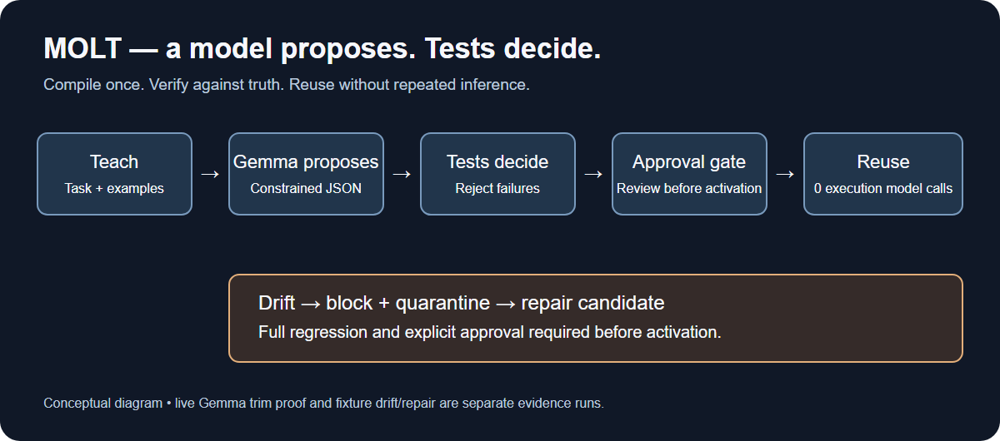

# Molt: teach once, test the recipe, reuse without another model call

<!--
PUBLISHING ATTACHMENT MAP
1. Upload evidence/pipeline.png after the lifecycle paragraph below.
2. Optional: upload a sanitized Molt dashboard screenshot at the dashboard slot
   below. Leave it empty if any CSV values, prompts, responses, file paths,
   credentials or account details are visible.
3. Optional: upload a Temporal UI screenshot at the Temporal slot below only if
   one was actually captured. Otherwise leave it empty; the JSON evidence is
   sufficient for the narrower live-workflow claim.
4. Do not upload Sentry screenshots: the inspected trace contained sensitive
   CSV values and local paths.
5. Do not look for a TabPFN dashboard screenshot: this was a local CPU run.
   Use evidence/TABPFN_PROOF.md and evidence/tabpfn-accuracy.json instead.
-->

Molt lets a local Gemma model propose a CSV recipe, but it does not trust the
proposal to run unattended. Tests decide whether the candidate matches the
expected output; an explicit approval gate comes next. In a live merchant-trim
demo, the recipe passed six checks and its approved execution used **zero model
calls**. That is the useful boundary: a model proposes the work; a deterministic
program repeats it. [Live record](evidence/lifecycle.json)

## First, the failure

One candidate described itself as trimming text, normalizing dates and parsing
amounts. Its actual operation list contained **only trim**. The `golden_output`
check rejected it. This is why the model's own explanation is not an approval
summary. [Rejected candidate](evidence/gemma-rung3-rejected-candidate.json)

The original local `gemma3:4b` task ladder used five trials per task:

| Task | First-request success | Success within its request budget | Request budget |
|---|---:|---:|---:|
| Trim merchant | 5/5 | 5/5 | 5 |
| Trim + dates | 4/5 | 5/5 | 5 |
| Trim + dates + decimals | 3/5 | 4/5 | 5 |
| Full expense task | 0/5 | 0/5 | 3 |

The original full-task trials all ended in timeouts. Nothing was activated by
that measurement. These are observed task trials with verified feedback retries,
not an unbiased statistical pass@k estimate. Budgets differed: the first three
rungs used a 45-second request timeout; the last used 30 seconds. Repeated
temperature-zero tasks on one machine are not evidence of general reliability.
[Table and individual records](evidence/gemma-ladder.csv)

### One bounded follow-up, then stop

I kept Gemma warm, shortened the prompt and raised the request timeout to 120
seconds. Five more trials, at most three requests each, still produced **0/5
passes**: **15 generation requests, one timeout, fourteen schema-valid recipes
rejected by verification**. Nothing was activated. This follow-up also used the
expanded verifier, so it is not an apples-to-apples model improvement score.
Two report writes were interrupted by Windows file locks; their verification
outcomes were recovered from SQLite, with total latency marked unavailable.
Staged compilation is a next step, not a feature quietly added before publishing.
[Separate follow-up record](evidence/gemma-full-task-followup.json)

## One lifecycle, two kinds of evidence

**Teach → Gemma proposes → tests decide → human approval gate → zero-call reuse
→ drift blocked → verified repair.**

The live trim recipe passed 6/6 checks, was activated by the demo script's explicit
approval call, then processed four rows with `llm_calls=0`. The saved execution
duration was 157.45 ms; that is one measurement, not a performance guarantee.
The gate supports human review, but this scripted activation is not proof that
an independent person reviewed the recipe.

Drift and repair evidence comes from separate fixture-backed runs, not one
continuous Gemma-generated repair demonstration. A required-column failure
blocked output, and a stored repair approval followed an 8/8 verification result.
A successful live Gemma-generated repair is **not shown**.
[Lifecycle records](evidence/lifecycle.json)



<!-- DASHBOARD IMAGE SLOT: upload only a fully sanitized Molt dashboard image here. -->

## The safety check needed checking too

The original mutation experiment rejected **18/20** candidates. Two slipped
through: deduplication on merchant instead of transaction ID happened to match
the small examples, and preserving an unknown category was never exercised.

I added independently authored examples: two distinct transactions sharing a
merchant, and an unknown category that must raise `UNMAPPED_VALUE`. The exact
original mutations were recovered from the session command and rerun. The old
fixtures reproduce **18/20**; the expanded suite rejects **20/20**. The correct
recipe still passes **11/11** checks.

That count includes schema-invalid candidates: **15 fixture-verification
failures and 5 schema rejections**, not twenty distinct semantic bugs caught by
example tests. This is a finite regression result, not universal correctness.
[Original](evidence/verifier-catch-rate.json) ·
[Reproducible before/after](evidence/verifier-catch-rate-after.json)

## What schema drift costs

`python bench.py` uses seed 41, an independent answer key, and a deliberately
naive positional script. It is not a comparison with every well-written script.

| Change | Naive script | Molt |
|---|---|---|
| Renamed customer column | Correct output | Blocked + quarantined |
| Dropped status column | Silent wrong output | Blocked + quarantined |
| Reordered columns | Silent wrong output | Succeeded |
| Extra column | Silent wrong output; drops extra field | Succeeded |

Three silent wrong outputs versus two Molt blocks. The cost is visible too:
Molt blocked the renamed-column case even though the positional script produced
the right output. Strict contracts trade that convenience for explicit review.
The successful Molt statuses are execution results; the benchmark does not yet
compare their output files to its independent oracle. No money or electricity
savings are inferred from these counts. [Benchmark](evidence/benchmark.json)

## Two optional integrations, narrowly demonstrated

**TabPFN:** a real CPU run performed supervised advisory classification on
synthetic, rule-generated batch-profile features. Of 300 held-out examples,
52 were true positives, 3 false positives, 225 true negatives and 20 false
negatives. Precision was **94.55%**, recall **72.22%**. The model flagged 55
examples and changed no source rows; source hashes matched before and after.
This is not real-world drift validation or unlabeled anomaly detection.
[Accuracy and provenance](evidence/tabpfn-accuracy.json) ·
[Local proof note](evidence/TABPFN_PROOF.md)

**Temporal:** a local server and worker completed a live workflow using the
**checked-in fixture recipe and a four-row file**, with three output rows and
zero model calls. The recipe was **not Gemma-generated**. This shows live
workflow execution; worker-crash recovery and production durability were not
demonstrated. [Workflow record](evidence/tabpfn-temporal-live.json)

<!-- TEMPORAL IMAGE SLOT: optional actual Temporal UI screenshot; omit if unavailable. -->

**Sentry:** telemetry is implemented, but the inspected live trace contained
sensitive CSV values and local file paths. I therefore do not show the trace or
claim sanitized dashboard evidence. The exposed DSN was rotated after review.

<!-- Do not attach the Sentry screenshots. The trace is intentionally omitted. -->

## Try the fixture demo

```text
python -m molt demo --offline --approve
```

Use Python 3.11+ from the repository. The offline demo needs no Ollama, API
credentials or network; it uses a checked-in recipe, not a live model.

## Why open and local matter

Ollama runs the compiler locally. Recipes are readable JSON rather than
arbitrary executable code, and the runtime can be inspected independently of
the model. Once approved, compatible execution needs no inference provider.
Optional telemetry and model-download authentication are separate boundaries;
"local" does not mean every optional integration is network-free.

TabPFN code and weights have separate licenses. Recent TabPFN weights are
**non-commercial**; check the selected checkpoint's terms before use or obtain
the appropriate commercial permission. [Upstream licensing](https://github.com/PriorLabs/TabPFN#license)

## Limits and not shown

Molt rejects unapproved candidates and blocks incompatible inputs in the
demonstrated service flow. It preserves sources and refuses existing output
paths in that service, but the legacy offline demo is not proof of every
overwrite-safety boundary. A wrong-but-passing recipe remains possible when
fixtures are weak. A careless approval can still authorize bad behavior.
Schema-valid data can be wrong, and no verifier here establishes business truth.
Golden and held-out expected rows are not sent to the compiler, but retry
feedback includes structural failures from those fixtures: they are development
regression tests, not a sealed final evaluation set.

Not shown: a successful live Gemma repair, a Temporal crash/restart exercise,
and a Sentry trace screenshot. Sentry is implemented, but the inspected trace
contained sensitive data, so it is intentionally omitted. Remaining screenshot
and publication tasks are tracked in [the capture checklist](evidence/CAPTURE_CHECKLIST.md).

#devchallenge #hf26challenge
